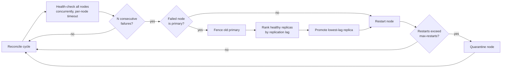

<div align="center">

# ⚡ AetherOps

**When the primary database dies at 3 a.m., who picks the replacement?**

A self-healing controller that detects a failed primary, fences it, and promotes the healthiest replica, plus a host provisioner that checks a Linux box before a database ever lands on it.


</div>

---

## Results at a glance

| | |
|---|---|
| **Failover** | 3 automatic failovers in a 30-cycle run at a 15% crash rate, every crashed node recovered |
| **Detection** | A node is declared dead only after N consecutive missed health checks, so one network blip doesn't trigger a failover |
| **Promotion** | The replica with the lowest replication lag wins; the old primary is fenced first |
| **Quality** | 73 pytest tests (system calls mocked), `mypy --strict` clean, standard library only |

```text
WARNING  FAILOVER #1: db-0 -> db-2 (replication lag 0.386s)
WARNING  FAILOVER #2: db-2 -> db-0 (replication lag 1.841s)
WARNING  FAILOVER #3: db-0 -> db-2 (replication lag 1.478s)
INFO     controller stopped after 30 cycles, 3 failovers
INFO     final cluster state: db-0 replica healthy | db-1 replica healthy | db-2 primary healthy
```
<sub>Reproduce it: `python -m src.cli start --interval 0.4 --nodes 3 --failure-rate 0.15 --failure-threshold 2 --seed 7 --max-cycles 30`</sub>

> **Status:** the cluster is simulated. Nodes crash at a configurable rate so the failover logic can be driven and tested end to end. Nodes implement a small `DatabaseNode` interface, so a real PostgreSQL adapter plugs in without touching the controller. That adapter is next on the roadmap.

---

## How it works



### 1. Host provisioner: `aetherops verify`

Checks a machine before it joins the cluster:

- **Platform guard:** parses `/etc/os-release` and refuses anything outside the Debian family
- **Packages:** validates `openssl`, `ca-certificates` and `postgresql-client` with `dpkg-query`, with retry and backoff on transient failures, and looks up install candidates with `apt-cache policy`
- **TLS:** generates a self-signed X.509 certificate and key with OpenSSL, including subjectAltName entries
- **Services:** simulated `systemctl` start, stop and restart with state tracking

### 2. Self-healing controller: `aetherops start`

- One `asyncio` loop checks every node at the same time, each with its own timeout
- Configurable failure threshold before a node is marked unhealthy
- Primary failover: fence, rank replicas by lag, promote
- Automatic restarts, and quarantine for nodes that keep failing

---

## Engineering decisions

**When is a node really dead?** Too eager and you fail over on a network blip; too patient and writes stall. AetherOps uses a consecutive-failure threshold (`--failure-threshold`) so a single slow response isn't treated as an outage.

**Why fence before promoting?** If the old primary comes back while a new one is already serving writes, you get split-brain. Fencing first makes sure only one primary exists.

**Why lowest lag?** The replica closest to the old primary has the least data to lose, so it's the safest one to promote.

**Why no dependencies?** The provisioner runs on fresh hosts before anything is installed. Standard library only means nothing to `pip install` first.

---

## Quick start

```bash
git clone https://github.com/HemanthGora1912/aetherops.git
cd aetherops

# Check a Debian/Ubuntu host and generate TLS material into ./certs
python -m src.cli verify --common-name db-0.internal --san db-0 --san localhost

# Run the self-healing controller
python -m src.cli start --nodes 3 --failure-rate 0.15 --failure-threshold 2 --seed 7 --max-cycles 30
```

On Windows, `run_demo.bat` runs the tests, the type check, the host check and the controller in one go.

<details>
<summary><b>All command-line options</b></summary>

| `start` option | Default | Meaning |
|---|---|---|
| `--interval` | 5.0 | Seconds between reconcile cycles |
| `--nodes` | 3 | Number of simulated nodes |
| `--failure-rate` | 0.05 | Chance each health check sees a crash |
| `--failure-threshold` | 3 | Consecutive failed checks before a node is unhealthy |
| `--health-timeout` | 2.0 | Timeout for each health check, in seconds |
| `--max-restarts` | 5 | Restarts before a node is quarantined |
| `--max-cycles` | none | Stop after N cycles |
| `--seed` | none | Random seed for reproducible runs |

`verify` options: `--cert-dir`, `--common-name`, `--san` (repeatable), `--days`, `--key-size` (2048/3072/4096), `--package` (repeatable), `--skip-os-check`, `--overwrite`.

Exit codes: `0` success, `1` failure, `2` bad arguments, `130` interrupted, so CI jobs can act on the result directly.

</details>

## Testing

```bash
pip install -r requirements-dev.txt
python -m pytest     # 73 tests; subprocess and file access are mocked
python -m mypy       # strict mode, configured in pyproject.toml
```

## Project layout

```
src/
├── sys_admin.py      host checks, package validation, TLS generation
├── orchestrator.py   asyncio health checks, failover, restart, quarantine
└── cli.py            argparse command-line interface
tests/                pytest suites for each module
```

## Roadmap

- [ ] PostgreSQL adapter for `DatabaseNode` (real health checks and `pg_promote()`)
- [ ] Prometheus metrics for failovers and node health
- [ ] Real `systemd` integration on Linux hosts

---

<div align="center">

Built by **Hemanth Gorapalli** · MS Data Science, UMBC · formerly server testing at Jabil

[LinkedIn](https://www.linkedin.com/in/hemanth-gorapalli-38a4212aa/)

</div>
